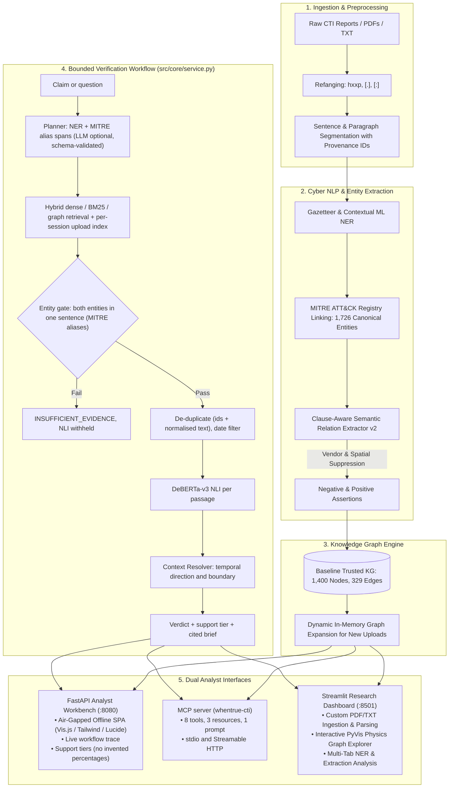

# CyberRAG: Provenance-Preserving CTI Knowledge Graph & Verification Platform

> **Graph-Augmented Retrieval, Cross-Encoder NLI Evidence Verification, and Context-Aware Contradiction Resolution for Cyber Threat Intelligence**

[](https://www.python.org/downloads/)
[](demo/)
[](https://streamlit.io/)
[](https://pytorch.org/)
[](https://huggingface.co/cross-encoder/nli-deberta-v3-base)
[](tests/)

---

## 1. Executive Summary & Core Motivation

Cyber Threat Intelligence (CTI) analysis requires synthesizing complex, multi-source reporting to track threat actors, malware strains, exploited vulnerabilities (CVEs), and attack infrastructure. However, deploying standard Large Language Models (LLMs) and naive Retrieval-Augmented Generation (RAG) pipelines in CTI introduces severe operational risks:

1. **Hallucination & Ungrounded Triples**: Standard LLMs infer non-existent threat actor relationships or fabricate CVE-malware links without verifiable textual grounding.
2. **False Consensus from Duplicate Reporting**: In open-source CTI, multiple reporting vendors frequently syndicate, quote, or rewrite the exact same underlying sentence. Standard vector retrieval aggregates these duplicates, mistaking repetitive syndication for independent corroborating consensus.
3. **Temporal Naivety in Contradiction Handling**: Threat intelligence changes dynamically over time. When an earlier report (e.g., October 2020) states *"Emotet delivers TrickBot"* and a later post-takedown report (e.g., May 2021) observes that Emotet infrastructure ceased distributing TrickBot, standard NLI and semantic retrieval flag this as a factual contradiction (`CONTRADICTED`), rather than recognizing an operational shift (**Temporal Supersedence**).
4. **Attribution Drift & Vendor Targeting**: Naive relationship extractors frequently mistake reporting cybersecurity vendors (e.g., *Mandiant*, *CrowdStrike*, *Zscaler*) or spatial descriptors (e.g., *across Europe*) for threat actors or victim targets.

**CyberRAG** solves these challenges by combining an audited, typed **Cyber Knowledge Graph**, **Hybrid Dense/Sparse/Graph Retrieval**, cross-encoder **Natural Language Inference (NLI)** verification with duplicate-aware provenance tracking, and an automated **Context-Aware Contradiction Resolver**.

---

## 2. Integrated System Architecture

CyberRAG operates as a multi-stage, provenance-preserving pipeline integrating a single `VerificationService` (bounded verification workflow), a verified knowledge graph, and three interfaces (Streamlit, FastAPI workbench and an MCP server):



### Component Breakdown
| Subsystem | Modules | Core Responsibility |
| :--- | :--- | :--- |
| **Data Ingestion** | `src/dataset/`, `src/preprocessor/` | Defangs network indicators (`hxxp[:]//`), performs NFKC unicode normalization, and segments text into 5,991 segments across 2,698 paragraphs with immutable provenance metadata (`report_id`, `source`, `publication_date`, `sentence_id`). |
| **Cyber NLP** | `src/nlp/` | Extracts 7 entity categories (*ThreatActor, Malware, Tool, CVE, Technique, Organization, Location*). Resolves aliases to 1,726 canonical MITRE ATT&CK entries. Clause-aware extractor extracts `USES`, `TARGETS`, `EXPLOITS`, and `USES_TECHNIQUE` while filtering reporting vendors and spatial prepositions. Preserves negative assertions (`polarity="negative"`) with full evidence grounding. |
| **Knowledge Graph** | `src/graph/` | Manages the baseline 1,400-node, 329-edge NetworkX Knowledge Graph. Supports in-memory dynamic expansion for live uploads without corrupting the baseline on disk. |
| **Core service** | `src/core/` | `VerificationService` is the single entry point used by Streamlit, FastAPI and MCP: validated config, typed errors, MITRE-registry alias resolver, planner, per-session upload store, STIX 2.1 export, structured logs. |
| **Verification workflow** | `src/agent/` | Thin adapter that renders the service result as a step trace (every sub-claim is verified). It is a fixed, bounded workflow, not an autonomous agent. |
| **MCP server** | `mcp_server/` | `whentrue-cti`: tools `search_evidence`, `verify_claim`, `verify_question`, `get_entity`, `get_timeline`, `ingest_report_preview/confirm`, `export_stix`. See `docs/MCP_GUIDE.md`. |
| **Hybrid Retrieval** | `src/retrieval.py`, `src/graph_retrieval.py` | Combines 384-dimensional dense semantic embeddings (`sentence-transformers/all-MiniLM-L6-v2`), BM25 token matching, and entity-linked graph assertion lookups. |
| **Evidence Verification** | `src/verification/` | Employs `cross-encoder/nli-deberta-v3-base` to evaluate hypothesis alignment against retrieved evidence. Softmax scores represent textual alignment rather than empirical certainty. Suppresses intra-vendor duplicate passages. |
| **Context Resolver** | `src/verification/context_resolver.py` | Classifies conflicting intelligence into a 4-tier CTI contradiction taxonomy: `TEMPORAL_SUPERSEDENCE`, `CAMPAIGN_DIVERGENCE`, `GENUINE_ATTRIBUTION_DISPUTE`, or `AMBIGUOUS_CONFLICT`. |
| **FastAPI Workbench** | `demo/server.py`, `demo/static/` | High-speed single-page application (`http://127.0.0.1:8080`) built with offline-bundled Tailwind, Vis.js, and Lucide. Features live structured decision traces, dynamic report ingestion, and local subgraph rendering. |
| **Streamlit Dashboard** | `app.py`, `src/ingestion.py` | Exploratory Streamlit interface (`http://127.0.0.1:8501`) supporting arbitrary PDF/TXT uploads, in-memory graph expansion, entity inspection tabs, and PyVis physics rendering. |

---

## 3. Knowledge Graph & Corpus Scale

The integrated baseline system operates over the following verified corpus metrics:

| Metric | Baseline Count | Description |
| :--- | :--- | :--- |
| **Baseline Graph Nodes** | **1,400** | Canonical threat actors, malware families, tools, CVEs, techniques, and sectors (combining MITRE ATT&CK ontology with extracted entities). |
| **Baseline Graph Edges** | **329** | Consolidated typed relational edges carrying multi-source provenance metadata. |
| **Baseline Assertions** | **374** | Discrete sentence-grounded relationship assertions with publication dates and sources. All records carry `trust_level: "unverified"` and `human_verified: false` denoting automated rule-based extraction without manual human review. |
| **Corpus Text Segments** | **5,991** | Paragraph- and sentence-level text chunks indexed across 2,698 paragraphs for dense and BM25 retrieval. |
| **MITRE ATT&CK Registry** | **1,726** | Canonical definitions ingested from STIX 2.1 Enterprise bundle (178 Actors, 747 Malware, 95 Tools, 706 Techniques). |
| **Precomputed Embeddings** | **9.2 MB** | 384-dim dense embeddings (`data/segment_embeddings_minilm.npy`) enabling instant cold starts. |

> **Note on Assertion Verification Status**:  
> In `data/assertions.jsonl`, each assertion record explicitly carries `"trust_level": "unverified"`, `"human_verified": false`, and `"verification_status": "unverified"`. These triples were generated via automated clause-aware syntactic extraction and entity-linking validation rules. They have not undergone manual line-by-line verification by a human intelligence analyst.

---

## 4. Key Architectural Decisions & Methodological Rigor

### A. Structured Evidence Reporting vs. Unconstrained LLM Generation
In high-stakes cybersecurity operations, unconstrained generative language models pose significant liability due to subtle hallucinations and ungrounded embellishment. CyberRAG's `AnswerGenerator` is deliberately designed to produce **structured, evidence-grounded intelligence syntheses** citing exact report IDs, sources, publication dates, and verbatim premise sentences, rather than generating free-form, unverified text.

### B. Precise Graph Retrieval (Entity-Linked Traversal)
Graph retrieval in CyberRAG is implemented as **entity-linked assertion lookup and multi-hop neighborhood traversal**. It indexes entities identified in the query, traverses adjacent extracted graph assertions, and pulls the underlying verbatim evidence sentences. It does not claim unbounded semantic graph reasoning; every graph triple is strictly bound to its ingested source sentence.

### C. NLI Alignment vs. Calibrated Factual Truth
Neural Natural Language Inference models output softmax probability distributions representing whether premise text *linguistically entails, contradicts, or remains neutral* to a hypothesis. CyberRAG explicitly treats these as **semantic textual alignment scores**, not calibrated probabilities of real-world historical fact. The platform separates linguistic NLI verification from the contextual domain logic that assesses source corroboration and temporal relevance.

### D. Multi-Publisher Corroboration & Duplicate Suppression
CTI vendors frequently syndicate identical sentences or cite the same primary disclosures. If two retrieved passages share identical text or originate from the same reporting publisher, CyberRAG flags them as duplicates. Rather than claiming "8 corroborating sources," the platform counts distinct reporting vendors (e.g., *Intel 471* and *Zscaler*) to prevent false consensus.

### E. Non-Destructive In-Memory Graph Expansion
When an analyst uploads a custom PDF or TXT report in the Streamlit application:
1. Cyber NLP extracts entities and relationships in real time.
2. Extracted intelligence is merged into an **in-memory session copy** of the Knowledge Graph.
3. Newly discovered entities glow in **neon cyan diamonds (`#00f5d4`)** on the canvas.
4. The baseline Knowledge Graph on disk (`data/cti_knowledge_graph_trusted.json`) remains completely pristine and immutable.

---

## 5. Demonstration Scenarios (Streamlit Presets)

The platform includes four pre-configured operational scenarios validating distinct capabilities using simulated demonstration reports modeled on primary intelligence publishers:

```
┌────────────────────────────────────────────────────────────────────────────────────────┐
│ Preset 1: APT28 Campaign Targeting NATO (Simulated QuoIntelligence-Style Report)       │
│ • Validates: Clause-aware extraction with spatial trigger suppression.                 │
│ • Result: APT28 USES Zebrocy (SUPPORTED); APT28 TARGETS NATO (SUPPORTED).              │
│ • Detail: "across Europe" suppressed from spatial targeting to prevent false targets.  │
│   Corroborated against QuoIntelligence reporting in the historical corpus.             │
├────────────────────────────────────────────────────────────────────────────────────────┤
│ Preset 2: Emotet Infrastructure Takedown (Simulated Europol / CISA-Style Report)       │
│ • Validates: Context-aware contradiction resolution over time.                         │
│ • Proposition: "Emotet USES TrickBot."                                                 │
│ • Historical Evidence (2020-10-15, Intel 471): Entailment (Emotet distributed TrickBot)│
│ • Later Evidence (2021-05-20, Europol/CISA): Contradiction (Post-seizure disruption)    │
│ • Result: CONFLICTING_EVIDENCE -> TEMPORAL_SUPERSEDENCE (+217 days, CONTRA_LATER).     │
│ • Interpretation: Operational shift over time, not a historical contradiction.        │
├────────────────────────────────────────────────────────────────────────────────────────┤
│ Preset 3: TrickBot-Emotet Malware Delivery Partnership (Simulated Intel 471-Style)     │
│ • Validates: Distinguishing independent vendor consensus from duplicated text.         │
│ • Result: SUPPORTED across 2 distinct publishers (Intel 471 & Zscaler).                │
│ • Detail: 3 duplicated text passages identified and suppressed from consensus count.   │
├────────────────────────────────────────────────────────────────────────────────────────┤
│ Preset 4: Sandworm & Cyclops Blink (Simulated CISA / UK NCSC-Style Report)             │
│ • Validates: Dynamic graph expansion + Entity-relevance evidence filtering.            │
│ • Graph Result: In-memory expansion (+2 nodes: Sandworm, Cyclops Blink; +5 edges).     │
│ • Verification Result: INSUFFICIENT_EVIDENCE (No matching evidence in baseline corpus). │
│ • Entity Filter: Irrelevant corpus passages (e.g. Taurus sandbox evasion) are          │
│   prevented from falsely scoring as contradictions on novel entities.                  │
└────────────────────────────────────────────────────────────────────────────────────────┘
```

---

## 6. Evaluation Framework & Benchmark Results

To maintain scientific integrity, evaluation metrics are segregated by benchmark protocol rather than conflated:

### 6.1 Primary Real-World Empirical Benchmark (AnnoCTR Corpus)
Evaluated directly against the official Bosch Research train (`ner_train.jsonl`, 7,570 sentences) and test (`ner_test.jsonl`, 3,059 sentences) splits with strictly **0% document overlap and zero leakage**:

| Model Architecture | Precision | Recall | F1 Score | Evaluation Protocol |
| :--- | :---: | :---: | :---: | :--- |
| **Baseline Gazetteer / Dictionary** | 0.3668 | 0.3342 | 0.3497 | Exact lexical matching against MITRE ontology |
| **Hybrid Contextual ML NER** | **0.3964** | **0.4933** | **0.4396** | Contextual sliding-window ML + Gazetteer + Aliases |
| **Relative Performance Delta** | **+8.1%** | **+47.6%** | **+25.7%** | Demonstrates substantial recall and discovery gain on noisy real-world CTI |

*This is the primary real-world benchmark. Performance on raw, unconstrained CTI text is F1 = 0.4396, reflecting the substantial difficulty of real-world threat reports (inconsistent terminology, complex nested clauses, and novel out-of-vocabulary threat actor handles). The hybrid model demonstrates a clear +25.7% relative F1 gain and +47.6% recall improvement over dictionary lookups on document-disjoint real-world test data.*

### 6.2 Controlled Pattern Extraction Test (Synthetic 50 Sentences)
* **Dataset**: A 50-sentence synthetic challenge benchmark (`data/benchmark/gold_standard_annotations.json`) designed to evaluate rule precision under ideal canonical entity representation.
* **Protocol**: Report-Level GroupKFold Cross-Validation (Leave-One-Report-Out across 6 report groups).
* **Results**: Precision = **0.8614**, Recall = **0.9355**, Overall F1 = **0.8969**.
* **Scope Note**: This score measures rule engine coverage under controlled conditions; it should not be conflated with the real-world AnnoCTR benchmark above.

### 6.3 Developer Test Paragraphs (Generalization Check)
* **Dataset**: 4 short developer-written test paragraphs (`data/unseen_reports/unseen_cti_reports.json`) containing 49 entity mentions and novel threat actors/malware (e.g., *Volt Typhoon*, *AcidRain*).
* **Results**: Precision = **0.9388**, Recall = **0.9020**, Overall F1 = **0.9200**.
* **Provenance Verification**: **100.0%** metadata compliance (zero missing report IDs, timestamps, or sentence references).

### 6.4 Retrieval ablation (withdrawn)
The v5 "LLM-enhanced retrieval ablation" is **not reported**. It was circular: the hand-written alias table that generated the retrieval gold labels was also given to the "expanded" system, so the gains did not measure retrieval quality. The script and its output were moved to `outputs/legacy/` with an explanation. A sound ablation is Stage 2 work.

### 6.5 Test suite
```bash
python -m pytest            # unit, condition-matrix, MCP contract, fuzz, e2e (real models if cached)
python run_tests.py         # same suites through unittest discovery
```
Real-model tests are skipped automatically if the models are not cached (`python scripts/download_models.py`). Set `CTI_RUN_REAL=0` to skip them explicitly. Latest measured numbers are in `CHANGELOG.md`.

---

## 7. Installation & Quickstart

### Prerequisites
* Python 3.10+ (tested on Python 3.10, 3.11)
* Git
* Internet only for the one-time model download (`python scripts/download_models.py`); everything runs offline afterwards

### Local Setup
```bash
# 1. Clone repository
git clone https://github.com/joshi-006/cyberrag.git
cd cyberrag

# 2. Create and activate a virtual environment
python -m venv venv
# On Windows:
.\venv\Scripts\activate
# On Linux/macOS:
source venv/bin/activate

# 3. Install dependencies
pip install --upgrade pip
pip install -r requirements.lock      # tested pins (or requirements.txt for loose bounds)
python scripts/download_models.py     # one time, while online
python scripts/build_manifest.py      # only if you intentionally changed files in data/
```

### Launch the Platform

#### Option A: Launch CyberRAG Analyst Workbench (FastAPI + Modern SPA)
```bash
python demo/server.py
```
Open `http://localhost:8080` in your browser for the full interactive CTI Analyst Command Center, featuring the live workflow trace, Knowledge Graph canvas, DeBERTa NLI probability gauges, custom report ingestion, and one-click benchmark scenarios.

#### Option B: Launch the MCP server
```bash
python -m mcp_server.server --transport stdio          # LM Studio / Claude Desktop
python -m mcp_server.server --transport http --port 8765   # remote agents, MCP Inspector
```
See `docs/MCP_GUIDE.md` for LM Studio, Claude Desktop and MCP Inspector setup.

#### Option C: Launch Streamlit Dashboard (frozen, kept working)
```bash
streamlit run app.py
```
Open `http://localhost:8501` in your browser. Select any of the preset scenarios or upload an arbitrary CTI PDF/TXT report.

### Run the Test Suite
```bash
python -m pytest
# or: python run_tests.py
```

### Run Full Data & Knowledge Graph Verification
```bash
python verify_pipeline.py
```

---

## 8. Docker Deployment

CyberRAG includes a containerized build for cloud environments (AWS ECS, GCP Cloud Run, Azure App Service, or private servers):

```bash
# Build Docker image
docker build -t cyberrag .

# Run the workbench (models are downloaded into the mounted cache on first run)
docker run -d -p 8080:8080 -v hf_cache:/root/.cache/huggingface --name cyberrag_app cyberrag
```
Access the workbench at `http://localhost:8080` (`/health` for liveness, `/ready` once models are loaded).

---

## 9. Streamlit Community Cloud Deployment

To deploy this repository on [Streamlit Community Cloud](https://share.streamlit.io/):
1. Fork or push this repository to your GitHub account.
2. Sign in to **Streamlit Community Cloud**.
3. Click **"New app"** and specify:
   * **Repository**: `your-username/cyberrag`
   * **Branch**: `main`
   * **Main file path**: `app.py`
4. Click **"Deploy!"**. The platform will install dependencies from `requirements.txt` and launch automatically.

---

## 10. Known Limitations & Threats to Validity

To ensure scientific honesty and transparency, we document several known limitations of the current implementation:

1. **Origin & Sparsity of the 1,400-Node Baseline Graph**:
   The baseline Knowledge Graph (`data/cti_knowledge_graph_trusted.json`) contains **1,400 consolidated entity nodes extracted across the full 104-report corpus** (spanning 2016–2022), with **415 nodes linked to canonical MITRE ATT&CK IDs**. The nodes are connected by **329 unique relation edges** derived from the 374 assertions extracted across 62 of those reports (2018–2022). However, the graph is sparse: only 277 of the 1,400 nodes have an edge, while 1,123 nodes (80.2%) remain isolated because most entity mentions in raw text do not appear in supported syntactic relation clauses. Running `run_pipeline.py` over the 30 curated demonstration reports alone yields a localized 209-node subnetwork.
2. **Assertion Predicates & Missing EXPLOITS Instances**:
   The 374 assertions comprise only three relation types: `TARGETS` (184), `USES` (99), and `USES_TECHNIQUE` (91). While syntactic rules for `EXPLOITS` are implemented in the extractor, the baseline corpus contains zero extracted `EXPLOITS` instances, and only 9 CVE entity nodes exist in the baseline graph.
3. **Automated Rule-Filtering & Unverified Baseline Assertions**:
   The 374 assertions in the baseline Knowledge Graph were extracted using automated syntactic pattern rules and entity-linking validation filters. In `data/assertions.jsonl`, each assertion explicitly stores `trust_level: "unverified"`, `human_verified: false`, and `verification_status: "unverified"`. None of the 374 assertions have undergone line-by-line manual verification by a human intelligence analyst.
4. **Unmeasured Relationship Precision on Real-World Corpus**:
   While Named Entity Recognition was empirically benchmarked against the official AnnoCTR dataset (achieving a modest F1 of 0.4396 on real-world noisy text), **relationship extraction precision on the unconstrained real-world corpus has never been empirically measured**. The AnnoCTR dataset provides ground-truth annotations exclusively for named entities, tactics, and techniques, not for relationship triples. While the clause-aware extractor rules pass all synthetic unit tests and regression checks, their precision and recall across the full corpus remain unbenchmarked against an annotated gold-standard relation corpus like AZERG.
5. **Polarity of Baseline Assertions & Negation Handling**:
   All 374 historical assertions stored in the static baseline graph are positive relations (`polarity="positive"`). Syntactic negation handling (`polarity="negative"`) was implemented and validated for **live dynamic ingestion of counter-evidence** (e.g., post-takedown reports in Preset 2). Negative statements about past campaigns are rare in baseline vendor reporting, so historical negative assertions were not pre-extracted across the entire static baseline.
6. **Graph Retrieval Scope**:
   Graph retrieval is implemented as entity-linked assertion lookup and adjacent neighborhood traversal. It retrieves evidence-grounded triples connected to extracted query entities; it does not perform unconstrained multi-hop inductive reasoning over arbitrary unindexed graph paths.

---

## 11. Citation & Acknowledgments

* **AnnoCTR Corpus**: Bosch Research, *AnnoCTR: A Dataset for Detecting and Linking Entities, Tactics, and Techniques in Cyber Threat Reports* (LREC-COLING 2024). Portions of this dataset are used under the **CC BY-SA 4.0** license. See [NOTICE.md](NOTICE.md) for full attribution.
* **MITRE ATT&CK**: The MITRE Corporation Enterprise ATT&CK Matrix (STIX 2.1).
* **Sentence Transformers**: `sentence-transformers/all-MiniLM-L6-v2`.
* **NLI Cross-Encoder**: `cross-encoder/nli-deberta-v3-base`.

---

## 12. License

This project is licensed under the **Apache License, Version 2.0**. See the [LICENSE](LICENSE) file for complete terms. Third-party datasets (such as the Bosch Research AnnoCTR corpus under CC BY-SA 4.0) and external frameworks are attributed in [NOTICE.md](NOTICE.md).


---

## 13. Known limitations added in v6 (Stage 1)

* NLI is sentence-level textual alignment. It can still accept a loosely related sentence (for example "TrickBot is operated by the actor that deploys Conti" entails "Conti uses TrickBot"). Support tiers and the entity gate reduce, but do not remove, this.
* One publisher is never `CORROBORATED`. Near-duplicate and syndicated reports are only caught when ids or normalised text match; independence grouping is Stage 2.
* `as_of_date` filters by publication date, not by when the event happened.
* Live uploads use gazetteer NER only (no trained ML NER artifact is shipped) and live for one session.
* The corpus is English only; non-English input returns `INSUFFICIENT_EVIDENCE` with a warning.
