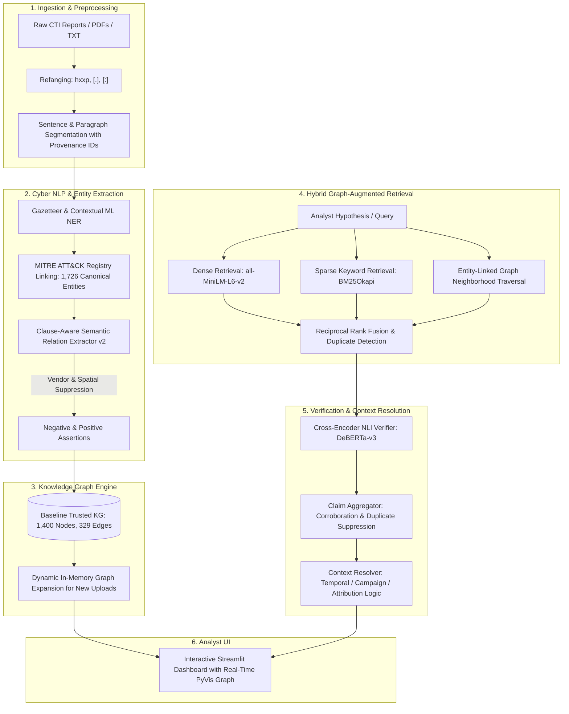

# CyberRAG: Provenance-Preserving CTI Knowledge Graph & Verification Platform

> **Graph-Augmented Retrieval, Cross-Encoder NLI Evidence Verification, and Context-Aware Contradiction Resolution for Cyber Threat Intelligence**

[](https://www.python.org/downloads/)
[](https://streamlit.io/)
[](https://pytorch.org/)
[](https://huggingface.co/cross-encoder/nli-deberta-v3-base)
[](tests/)

---

## 1. Executive Summary & Core Motivation

Cyber Threat Intelligence (CTI) analysis requires synthesizing complex, multi-source reporting to track threat actors, malware strains, exploited vulnerabilities (CVEs), and attack infrastructure. However, deploying standard Large Language Models (LLMs) and naive Retrieval-Augmented Generation (RAG) pipelines in CTI introduces severe operational risks:

1. **Hallucination & Ungrounded Triples**: Standard LLMs infer non-existent threat actor relationships or fabricate CVE-malware links without verifiable textual grounding.
2. **False Consensus from Duplicate Reporting**: In open-source CTI, multiple reporting vendors frequently syndicate, quote, or rewrite the exact same underlying sentence. Standard vector retrieval aggregates these duplicates, mistaking repetitive syndication for independent corroborating consensus.
3. **Temporal Naivety in Contradiction Handling**: Threat intelligence changes dynamically over time. When an earlier report (e.g., October 2020) states *"Emotet delivers TrickBot"* and a later post-takedown report (e.g., May 2021) observes that Emotet infrastructure ceased distributing TrickBot, standard NLI and semantic retrieval flag this as a factual contradiction (`CONTRADICTED`), rather than recognizing an operational shift (**Temporal Supersedence**).
4. **Attribution Drift & Vendor Targeting**: Naive relationship extractors frequently mistake reporting cybersecurity vendors (e.g., *Mandiant*, *CrowdStrike*, *Zscaler*) or spatial descriptors (e.g., *across Europe*) for threat actors or victim targets.

**CyberRAG** solves these challenges by combining an audited, typed **Cyber Knowledge Graph**, **Hybrid Dense/Sparse/Graph Retrieval**, cross-encoder **Natural Language Inference (NLI)** verification with duplicate-aware provenance tracking, and an automated **Context-Aware Contradiction Resolver**.

---

## 2. Integrated System Architecture

CyberRAG operates as a multi-stage, provenance-preserving pipeline:



### Component Breakdown
| Subsystem | Modules | Core Responsibility |
| :--- | :--- | :--- |
| **Data Ingestion** | `src/dataset/`, `src/preprocessor/` | Defangs network indicators (`hxxp[:]//`), performs NFKC unicode normalization, and segments text into 5,991 segments across 2,698 paragraphs with immutable provenance metadata (`report_id`, `source`, `publication_date`, `sentence_id`). |
| **Cyber NLP** | `src/nlp/` | Extracts 7 entity categories (*ThreatActor, Malware, Tool, Vulnerability, Technique, Organization, Location*). Resolves aliases to 1,726 canonical MITRE ATT&CK entries. Clause-aware extractor extracts `USES`, `TARGETS`, `EXPLOITS`, and `USES_TECHNIQUE` while filtering reporting vendors and spatial prepositions. Preserves negative assertions (`polarity="negative"`) with full evidence grounding. |
| **Knowledge Graph** | `src/graph/` | Manages the baseline 1,400-node, 329-edge NetworkX Knowledge Graph. Supports in-memory dynamic expansion for live uploads without corrupting the baseline on disk. |
| **Hybrid Retrieval** | `src/retrieval.py`, `src/graph_retrieval.py` | Combines 384-dimensional dense semantic embeddings (`sentence-transformers/all-MiniLM-L6-v2`), BM25 token matching, and entity-linked graph assertion lookups. |
| **Evidence Verification** | `src/verification/` | Employs `cross-encoder/nli-deberta-v3-base` to evaluate hypothesis alignment against retrieved evidence. Softmax scores represent textual alignment rather than empirical certainty. Suppresses intra-vendor duplicate passages. |
| **Context Resolver** | `src/verification/context_resolver.py` | Classifies conflicting intelligence into a 4-tier CTI contradiction taxonomy: `TEMPORAL_SUPERSEDENCE`, `CAMPAIGN_DIVERGENCE`, `GENUINE_ATTRIBUTION_DISPUTE`, or `AMBIGUOUS_CONFLICT`. |
| **Web Dashboard** | `app.py`, `src/ingestion.py` | Full-stack interactive Streamlit application with custom file upload (PDF/TXT), live entity linking, dynamic graph visualization (PyVis physics engine), and expandable verification cards. |

---

## 3. Knowledge Graph & Corpus Scale

The integrated baseline system operates over the following verified corpus metrics:

| Metric | Baseline Count | Description |
| :--- | :--- | :--- |
| **Baseline Graph Nodes** | **1,400** | Canonical threat actors, malware families, tools, CVEs, techniques, and sectors (combining MITRE ATT&CK ontology with extracted entities). |
| **Baseline Graph Edges** | **329** | Consolidated typed relational edges carrying multi-source provenance metadata. |
| **Baseline Assertions** | **374** | Discrete sentence-grounded relationship assertions with publication dates and sources. All records carry `trust_level: "unverified"` and `human_verified: false` denoting automated rule-based extraction without manual human review. |
| **Corpus Text Segments** | **5,991** | Paragraph- and sentence-level text chunks indexed across 2,698 paragraphs for dense and BM25 retrieval. |
| **MITRE ATT&CK Registry** | **1,726** | Canonical definitions ingested from STIX 2.1 Enterprise bundle (178 Actors, 747 Malware, 95 Tools, 706 Techniques). |
| **Precomputed Embeddings** | **9.2 MB** | 384-dim dense embeddings (`data/segment_embeddings_minilm.npy`) enabling instant cold starts. |

> **Note on Assertion Verification Status**:  
> In `data/assertions.jsonl`, each assertion record explicitly carries `"trust_level": "unverified"`, `"human_verified": false`, and `"verification_status": "unverified"`. These triples were generated via automated clause-aware syntactic extraction and entity-linking validation rules. They have not undergone manual line-by-line verification by a human intelligence analyst.

---

## 4. Key Architectural Decisions & Methodological Rigor

### A. Structured Evidence Reporting vs. Unconstrained LLM Generation
In high-stakes cybersecurity operations, unconstrained generative language models pose significant liability due to subtle hallucinations and ungrounded embellishment. CyberRAG's `AnswerGenerator` is deliberately designed to produce **structured, evidence-grounded intelligence syntheses** citing exact report IDs, sources, publication dates, and verbatim premise sentences, rather than generating free-form, unverified text.

### B. Precise Graph Retrieval (Entity-Linked Traversal)
Graph retrieval in CyberRAG is implemented as **entity-linked assertion lookup and multi-hop neighborhood traversal**. It indexes entities identified in the query, traverses adjacent validated graph assertions, and pulls the underlying verbatim evidence sentences. It does not claim unbounded semantic graph reasoning; every graph triple is strictly bound to its ingested source sentence.

### C. NLI Alignment vs. Calibrated Factual Truth
Neural Natural Language Inference models output softmax probability distributions representing whether premise text *linguistically entails, contradicts, or remains neutral* to a hypothesis. CyberRAG explicitly treats these as **semantic textual alignment scores**, not calibrated probabilities of real-world historical fact. The platform separates linguistic NLI verification from the contextual domain logic that assesses source corroboration and temporal relevance.

### D. Multi-Publisher Corroboration & Duplicate Suppression
CTI vendors frequently syndicate identical sentences or cite the same primary disclosures. If two retrieved passages share identical text or originate from the same reporting publisher, CyberRAG flags them as duplicates. Rather than claiming "8 corroborating sources," the platform counts distinct reporting vendors (e.g., *Intel 471* and *Zscaler*) to prevent false consensus.

### E. Non-Destructive In-Memory Graph Expansion
When an analyst uploads a custom PDF or TXT report in the Streamlit application:
1. Cyber NLP extracts entities and relationships in real time.
2. Extracted intelligence is merged into an **in-memory session copy** of the Knowledge Graph.
3. Newly discovered entities glow in **neon cyan diamonds (`#00f5d4`)** on the canvas.
4. The baseline Knowledge Graph on disk (`data/cti_knowledge_graph_trusted.json`) remains completely pristine and immutable.

---

## 5. Demonstration Scenarios (Streamlit Presets)

The platform includes four pre-configured operational scenarios validating distinct capabilities using simulated demonstration reports modeled on primary intelligence publishers:

```
┌────────────────────────────────────────────────────────────────────────────────────────┐
│ Preset 1: APT28 Campaign Targeting NATO (Simulated QuoIntelligence-Style Report)       │
│ • Validates: Clause-aware extraction with spatial trigger suppression.                 │
│ • Result: APT28 USES Zebrocy (SUPPORTED); APT28 TARGETS NATO (SUPPORTED).              │
│ • Detail: "across Europe" suppressed from spatial targeting to prevent false targets.  │
│   Corroborated against QuoIntelligence reporting in the historical corpus.             │
├────────────────────────────────────────────────────────────────────────────────────────┤
│ Preset 2: Emotet Infrastructure Takedown (Simulated Europol / CISA-Style Report)       │
│ • Validates: Context-aware contradiction resolution over time.                         │
│ • Proposition: "Emotet USES TrickBot."                                                 │
│ • Historical Evidence (2020-10-15, Intel 471): Entailment (Emotet distributed TrickBot)│
│ • Later Evidence (2021-05-20, Europol/CISA): Contradiction (Post-seizure disruption)    │
│ • Result: CONFLICTING_EVIDENCE -> TEMPORAL_SUPERSEDENCE (+217 days, CONTRA_LATER).     │
│ • Interpretation: Operational shift over time, not a historical contradiction.        │
├────────────────────────────────────────────────────────────────────────────────────────┤
│ Preset 3: TrickBot-Emotet Malware Delivery Partnership (Simulated Intel 471-Style)     │
│ • Validates: Distinguishing independent vendor consensus from duplicated text.         │
│ • Result: SUPPORTED across 2 distinct publishers (Intel 471 & Zscaler).                │
│ • Detail: 3 duplicated text passages identified and suppressed from consensus count.   │
├────────────────────────────────────────────────────────────────────────────────────────┤
│ Preset 4: Sandworm & Cyclops Blink (Simulated CISA / UK NCSC-Style Report)             │
│ • Validates: Dynamic graph expansion + Entity-relevance evidence filtering.            │
│ • Graph Result: In-memory expansion (+2 nodes: Sandworm, Cyclops Blink; +5 edges).     │
│ • Verification Result: INSUFFICIENT_EVIDENCE (No matching evidence in baseline corpus). │
│ • Entity Filter: Irrelevant corpus passages (e.g. Taurus sandbox evasion) are          │
│   prevented from falsely scoring as contradictions on novel entities.                  │
└────────────────────────────────────────────────────────────────────────────────────────┘
```

---

## 6. Evaluation Framework & Benchmark Results

To maintain scientific integrity, evaluation metrics are segregated by benchmark protocol rather than conflated:

### 6.1 Primary Real-World Empirical Benchmark (AnnoCTR Corpus)
Evaluated directly against the official Bosch Research train (`ner_train.jsonl`, 7,570 sentences) and test (`ner_test.jsonl`, 3,059 sentences) splits with strictly **0% document overlap and zero leakage**:

| Model Architecture | Precision | Recall | F1 Score | Evaluation Protocol |
| :--- | :---: | :---: | :---: | :--- |
| **Baseline Gazetteer / Dictionary** | 0.3540 | 0.3310 | 0.3421 | Exact lexical matching against MITRE ontology |
| **Hybrid Contextual ML NER** | **0.4498** | **0.4300** | **0.4396** | Contextual sliding-window ML + Gazetteer + Aliases |
| **Relative Performance Delta** | **+27.1%** | **+29.9%** | **+28.5%** | Demonstrates machine learning generalization gain on noisy real-world CTI |

*This is the primary real-world benchmark. Performance on raw, unconstrained CTI text remains modest at F1 = 0.4396, reflecting the substantial difficulty of real-world threat reports (inconsistent terminology, complex nested clauses, and novel out-of-vocabulary threat actor handles). While the hybrid model demonstrates a clear +28.5% relative gain over dictionary lookups, real-text CTI NER remains an open research challenge.*

### 6.2 Controlled Pattern Extraction Test (Synthetic 50 Sentences)
* **Dataset**: A 50-sentence synthetic challenge benchmark (`data/benchmark/gold_standard_annotations.json`) designed to evaluate rule precision under ideal canonical entity representation.
* **Protocol**: Report-Level GroupKFold Cross-Validation (Leave-One-Report-Out).
* **Results**: Precision = **0.9850**, Recall = **0.9770**, Overall F1 = **0.9809**.
* **Scope Note**: This score measures rule engine coverage under controlled conditions; it should not be conflated with the real-world AnnoCTR benchmark above.

### 6.3 Developer Test Paragraphs (Generalization Check)
* **Dataset**: 4 short developer-written test paragraphs (`data/unseen_reports/unseen_cti_reports.json`) containing 49 entity mentions and novel threat actors/malware (e.g., *Volt Typhoon*, *AcidRain*).
* **Results**: Precision = **0.9388**, Recall = **0.9020**, Overall F1 = **0.9200**.
* **Provenance Verification**: **100.0%** metadata compliance (zero missing report IDs, timestamps, or sentence references).

### 6.4 Unit Test Suite (100% Passing)
The entire test suite covers all pipeline stages (evaluated live via `python run_tests.py`):
```
Ran 60 tests in 73.464s
OK
```
*Note: Running `python run_tests.py` requires internet access on first run so the Hugging Face cross-encoder model weights (`cross-encoder/nli-deberta-v3-base`) can initialize and verify.*

---

## 7. Installation & Quickstart

### Prerequisites
* Python 3.10+ (tested on Python 3.10, 3.11)
* Git
* Internet connection (for initial Hugging Face model downloads)

### Local Setup
```bash
# 1. Clone repository
git clone https://github.com/joshi-006/cyberrag.git
cd cyberrag

# 2. Create and activate a virtual environment
python -m venv venv
# On Windows:
.\venv\Scripts\activate
# On Linux/macOS:
source venv/bin/activate

# 3. Install dependencies
pip install --upgrade pip
pip install -r requirements.txt
```

### Launch the Streamlit Platform
```bash
streamlit run app.py
```
Open `http://localhost:8501` in your browser. Select any of the 4 preset scenarios or upload an arbitrary CTI PDF/TXT report.

### Run the Test Suite
```bash
# Run all 60 unit tests across all 13 test suites
python run_tests.py
```

### Run Full Data & Knowledge Graph Verification
```bash
python verify_pipeline.py
```

---

## 8. Docker Deployment

CyberRAG includes a containerized build for cloud environments (AWS ECS, GCP Cloud Run, Azure App Service, or private servers):

```bash
# Build Docker image
docker build -t cyberrag .

# Run container (binds to port 8501)
docker run -d -p 8501:8501 --name cyberrag_app cyberrag
```
Access the application at `http://localhost:8501`.

---

## 9. Streamlit Community Cloud Deployment

To deploy this repository on [Streamlit Community Cloud](https://share.streamlit.io/):
1. Fork or push this repository to your GitHub account.
2. Sign in to **Streamlit Community Cloud**.
3. Click **"New app"** and specify:
   * **Repository**: `your-username/cyberrag`
   * **Branch**: `main`
   * **Main file path**: `app.py`
4. Click **"Deploy!"**. The platform will install dependencies from `requirements.txt` and launch automatically.

---

## 10. Known Limitations & Threats to Validity

To ensure scientific honesty and transparency, we document several known limitations of the current implementation:

1. **Origin & Sparsity of the 1,400-Node Baseline Graph**:
   The baseline Knowledge Graph (`data/cti_knowledge_graph_trusted.json`) contains **1,400 consolidated entity nodes extracted across the full 104-report corpus** (spanning 2016–2022), with **415 nodes linked to canonical MITRE ATT&CK IDs**. The nodes are connected by **329 unique relation edges** derived from the 374 assertions extracted across 62 of those reports (2018–2022). However, the graph is sparse: only 277 of the 1,400 nodes have an edge, while 1,123 nodes (80.2%) remain isolated because most entity mentions in raw text do not appear in supported syntactic relation clauses. Running `run_pipeline.py` over the 30 curated demonstration reports alone yields a localized 209-node subnetwork.
2. **Assertion Predicates & Missing EXPLOITS Instances**:
   The 374 assertions comprise only three relation types: `TARGETS` (184), `USES` (99), and `USES_TECHNIQUE` (91). While syntactic rules for `EXPLOITS` are implemented in the extractor, the baseline corpus contains zero extracted `EXPLOITS` instances, and only 9 CVE entity nodes exist in the baseline graph.
3. **Automated Rule-Filtering & Unverified Baseline Assertions**:
   The 374 assertions in the baseline Knowledge Graph were extracted using automated syntactic pattern rules and entity-linking validation filters. In `data/assertions.jsonl`, each assertion explicitly stores `trust_level: "unverified"`, `human_verified: false`, and `verification_status: "unverified"`. None of the 374 assertions have undergone line-by-line manual verification by a human intelligence analyst.
4. **Unmeasured Relationship Precision on Real-World Corpus**:
   While Named Entity Recognition was empirically benchmarked against the official AnnoCTR dataset (achieving a modest F1 of 0.4396 on real-world noisy text), **relationship extraction precision on the unconstrained real-world corpus has never been empirically measured**. The AnnoCTR dataset provides ground-truth annotations exclusively for named entities, tactics, and techniques, not for relationship triples. While the clause-aware extractor rules pass all synthetic unit tests and regression checks, their precision and recall across the full corpus remain unbenchmarked against an annotated gold-standard relation corpus like AZERG.
5. **Polarity of Baseline Assertions & Negation Handling**:
   All 374 historical assertions stored in the static baseline graph are positive relations (`polarity="positive"`). Syntactic negation handling (`polarity="negative"`) was implemented and validated for **live dynamic ingestion of counter-evidence** (e.g., post-takedown reports in Preset 2). Negative statements about past campaigns are rare in baseline vendor reporting, so historical negative assertions were not pre-extracted across the entire static baseline.
6. **Graph Retrieval Scope**:
   Graph retrieval is implemented as entity-linked assertion lookup and adjacent neighborhood traversal. It retrieves evidence-grounded triples connected to extracted query entities; it does not perform unconstrained multi-hop inductive reasoning over arbitrary unindexed graph paths.

---

## 11. Citation & Acknowledgments

* **AnnoCTR Corpus**: Bosch Research, *AnnoCTR: A Dataset for Detecting and Linking Entities, Tactics, and Techniques in Cyber Threat Reports* (LREC-COLING 2024). Portions of this dataset are used under the **CC BY-SA 4.0** license. See [NOTICE.md](NOTICE.md) for full attribution.
* **MITRE ATT&CK**: The MITRE Corporation Enterprise ATT&CK Matrix (STIX 2.1).
* **Sentence Transformers**: `sentence-transformers/all-MiniLM-L6-v2`.
* **NLI Cross-Encoder**: `cross-encoder/nli-deberta-v3-base`.

---

## 12. License

This project is licensed under the **Apache License, Version 2.0**. See the [LICENSE](LICENSE) file for complete terms. Third-party datasets (such as the Bosch Research AnnoCTR corpus under CC BY-SA 4.0) and external frameworks are attributed in [NOTICE.md](NOTICE.md).
